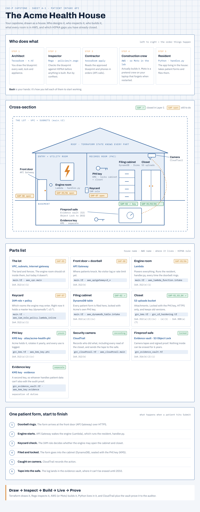

# Architecture: Acme Health Patient Intake API

## What it does

The Patient Intake API lets patients fill in their basic information, such as name, date of birth and health details. That information is PHI (protected health information), which is why the HIPAA Security Rule applies.

Request path: `POST /intake` -> API Gateway v2 -> Lambda (`handler.py`) -> DynamoDB table (form data) + S3 uploads bucket (attachments).

## How the data is protected

KMS makes stolen data unreadable. TLS stops cleartext interception. Versioning lets us recover overwritten or deleted files. And the Lambda can only perform the exact API actions on the exact resources it needs to fulfill its specific function, nothing more.

| Control | Where | HIPAA |
|---|---|---|
| Customer-managed KMS key on S3 and DynamoDB | `terraform/grc_kms.tf`, `terraform/main.tf` | 164.312(a)(2)(iv) |
| TLS-only bucket policies | `terraform/grc_s3_hardening.tf`, `terraform/grc_cloudtrail.tf` | 164.312(e)(1) |
| Versioning on uploads | `terraform/grc_s3_hardening.tf` | 164.308(a)(7)(ii)(A) |
| Least-privilege Lambda role | `terraform/grc_iam_least_privilege.tf` | 164.312(a)(1) |
| CloudTrail into the evidence vault | `terraform/grc_cloudtrail.tf` | 164.312(b) |
| 6-year Object Lock evidence vault | `terraform/grc_evidence_vault.tf` | 164.316(b)(2)(i) |

## How a change gets in

When I open a PR, the pipeline checks the Terraform plan against my 5 HIPAA policies. In PR #3 the policy wasn't met, so GitHub blocked the merge. Once a PR passes and is merged, the pipeline applies it, signs the evidence and stores it.

## Why evidence is signed and kept for 6 years

The rule, 45 CFR 164.316(b)(2)(i): "Retain the documentation required by paragraph (b)(1) of this section for 6 years from the date of its creation or the date when it last is in effect, whichever is later."

We store evidence in an Object Lock vault for 6 years so that it cannot be altered. It gets signed with each bundle so that anyone can verify the integrity.

Limitation: the vault keeps each file for a fixed 6 years from upload. Policy documents that stay in effect longer would need their retention extended, because of "whichever is later".

## AI assistance

The diagram and the pipeline were drafted with help from Claude; I reviewed, ran and verified every step.
